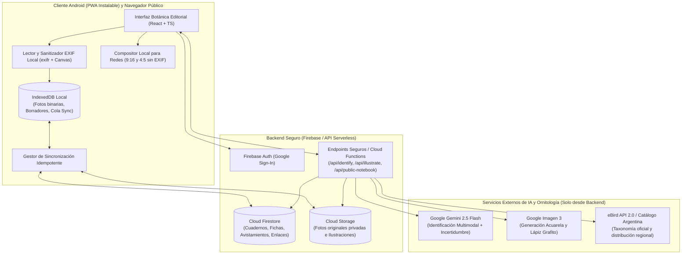

# Cuaderno de Aves — Diseño Técnico, Decisión de Stack y Plan de Implementación (MVP)

**Fecha:** 19 de octubre de 2026  
**Documento:** Entregable de Arquitectura, Matriz Tecnológica y Resolución de Diseño (§8, §11 CA17, §13 y §14)  
**Usuaria principal:** Valeria  
**Idioma:** Español rioplatense (`es-AR`)

---

## 1. Revisión de Producto y Resolución de Cuestiones de Diseño (§13.1 y §14)

Antes de construir, se analizaron las ambigüedades y decisiones abiertas de la especificación. A continuación se documentan las reglas adoptadas y validadas para el MVP:

### 1.1. Umbrales de incertidumbre y flujo de confirmación/corrección de especie (§5 F03, §14)
- **Por qué no basta un número crudo del LLM:** Los modelos multimodales tienden a expresar alta confianza numérica incluso ante fotos ambiguas. Por ello, el motor de identificación combina:
  1. **Evaluación de calidad visual de la toma:** ¿hay un ave visible?, ¿qué proporción del cuerpo y rasgos diagnósticos (pico, cabeza, alas, cola, patrón de plumaje) se distinguen con nitidez?
  2. **Consistencia morfológica y geográfica:** contraste de las especies candidatas contra el catálogo taxonómico de aves de Argentina (eBird `es_AR`) y la región/época del avistamiento cuando esté disponible.
- **Categorías comprensibles para Valeria (sin porcentajes engañosos):**
  - **Seguridad Alta («Identificación muy probable»):** Rasgos diagnósticos claros y especie frecuente/compatible con la zona. Se presenta la especie principal lista para confirmar con un toque, más hasta 2 alternativas por si desea comparar.
  - **Seguridad Media / Con Duda («Necesita tu confirmación» → estado `requiere_confirmacion`):** Foto a contraluz, ave parcialmente oculta o especies visualmente muy similares (p. ej., distintos tiránidos o espiguilleros). Se declaran explícitamente los motivos de duda y se muestran entre 2 y 3 tarjetas candidatas con sus rasgos clave para que Valeria elija o busque manualmente en el catálogo.
  - **Evidencia Insuficiente («No pudimos distinguir el ave con seguridad» → estado `pendiente_identificacion`):** Foto muy borrosa, ave demasiado lejana o imagen sin aves. No se adjudica ninguna especie arbitrariamente; se conserva el avistamiento como «Pendiente de identificar» permitiendo reintentar luego o reemplazar/agregar otra fotografía.

### 1.2. Contenido público por defecto en cuadernos compartidos (§5 F08, §14)
- **Decisión de UX acordada:**
  - **Por defecto:** Al activar «Compartir cuaderno», el enlace público de solo lectura publica **únicamente la portada del cuaderno, las láminas ilustradas (`acuarela_naturalista` o `lapiz_grafito`), los nombres común/científico, la ficha educativa breve y la fecha (día/mes/año) del primer avistamiento**.
  - **Consentimiento explícito por cuaderno:** En el panel «Compartir cuaderno», Valeria dispone de dos interruptores independientes y desactivados por defecto:
    1. *«Incluir mis fotografías originales en la vista compartida»*
    2. *«Incluir mis notas personales de avistamiento»*
  - **Garantía absoluta de privacidad (CA14):** Ni siquiera activando ambos interruptores se exponen jamás coordenadas GPS, direcciones exactas, metadatos EXIF originales ni datos de la cuenta de Google. Las imágenes servidas en vistas públicas o exportadas para redes pasan por un proceso de **sanitización de píxeles (re-codificación limpia sin cabeceras EXIF/GPS)**.

### 1.3. Reutilización de ilustraciones entre cuadernos del mismo estilo (§4.2, §4.4, §14)
- **Regla adoptada:** Las ilustraciones generadas se indexan por la clave compuesta `(taxonId, estilo)`.
- Si Valeria confirma un *Hornero (`Furnarius rufus`)* en un segundo cuaderno que también usa `acuarela_naturalista`, **se reutiliza automáticamente la ilustración existente** para mantener coherencia artística y evitar costos y esperas innecesarias (CA16).
- En cualquier momento, desde la ficha de la especie en ese cuaderno, Valeria puede tocar **«Pedir otra versión de la ilustración»** (CA08) si desea una pose distinta o una variante exclusiva sin perder sus fotografías ni su historial.

### 1.4. Correcciones taxonómicas y fusión/separación de fichas (§5 F06, §14)
- Cuando Valeria corrige la especie asignada a un avistamiento ya registrado en un cuaderno:
  1. **Si la nueva especie ya tiene lámina en ese cuaderno:** El avistamiento (con su foto, fecha y nota) se traslada al historial de la lámina existente (CA06).
  2. **Si la nueva especie no existe aún en ese cuaderno:** Se crea la lámina para la nueva especie y se vincula o genera su ilustración en el estilo del cuaderno.
  3. **Limpieza de la ficha anterior:** Si el avistamiento corregido era el único que sostenía la ficha anterior en ese cuaderno, dicha ficha se retira del índice activo del cuaderno (conservando la ilustración en caché por `(taxonId, estilo)` por si vuelve a observarse en el futuro). Si la ficha anterior tenía más avistamientos, permanece activa con los restantes.

### 1.5. Persistencia local en IndexedDB, retención e idempotencia de sincronización (§6, §14)
- **Separación estricta entre metadatos y binarios:** Un avistamiento solo pasa a estado de sincronización `respaldado` cuando:
  1. El archivo binario original de la foto se subió con éxito a Cloud Storage (verificado mediante hash SHA-256 / confirmación de subida).
  2. La ilustración asociada (cuando ya está confirmada la especie) se encuentra persistida en almacenamiento permanente.
  3. El documento estructurado en Firestore se guardó con las referencias finales.
- **Idempotencia:** Cada avistamiento recibe al crearse en el teléfono un identificador determinístico `clientSightingId` (UUID v4) y el hash SHA-256 de la imagen. Si la conexión se corta en el fondo del jardín y la cola reintenta la operación, la ruta de Storage (`users/{uid}/sightings/{clientSightingId}/original.jpg`) y el documento (`sightings/{clientSightingId}`) se sobrescriben de forma idempotente sin duplicar registros ni cobros de IA.
- **Retención local:** Los blobs originales en IndexedDB se conservan localmente mientras el estado sea `local`, `subiendo` o `error`. Una vez confirmado el estado `respaldado`, se conserva una miniatura optimizada en caché local (con límite LRU de 150 MB) para lectura instantánea offline sin agotar el almacenamiento del teléfono.

### 1.6. Formatos de exportación para redes sociales y compatibilidad (§5 F07, §14)
- El compositor de láminas para compartir genera localmente en el cliente (sobre HTML5 Canvas de alta resolución, sin llamar de nuevo a la IA generativa y sin ningún metadato EXIF) dos formatos seleccionables:
  - **Historia / Estado (9:16 — `1080 × 1920 px`):** Ideal para Historias de Instagram y Estados de WhatsApp.
  - **Publicación / Retrato (4:5 — `1080 × 1350 px`):** Ideal para Feed de Instagram, WhatsApp y envío por chat.
- En ambos formatos Valeria puede alternar en vivo entre:
  - **Variante A:** *Solo ilustración artística + datos básicos + firma discreta (`«Aves de mi jardín — Valeria»`)*.
  - **Variante B:** *Ilustración artística + fotografía original en recuadro tipo polaroid/sello de campo + datos básicos + firma discreta*.
- **Mecanismo de envío:** En Android se invoca `navigator.share({ files: [archivoPng], title, text })` (Web Share API Level 2), que abre la hoja nativa de Android para compartir directo a Instagram, WhatsApp, Telegram, etc. Si el navegador o dispositivo no soporta compartir archivos directamente, se ofrece un botón inmediato de **«Guardar imagen en el teléfono / Descargar lámina»** junto con copiar el texto sugerido.

---

## 2. Evaluación y Decisión del Stack Tecnológico (§8, §11 CA17, §13.2)

### 2.1. Matriz comparativa de alternativas

| Criterio (§8) | Opción 1: Flutter Android + Web App Pública separada | Opción 2 (Seleccionada): PWA Mobile-First (React + TypeScript + Vite) + Vista Web Pública unificada | Opción 3: Híbrida (Capacitor + React) |
| :--- | :--- | :--- | :--- |
| **1. Galería, cámara y lectura de EXIF** | Muy buena mediante plugins nativos (`image_picker`, `exif`). | **Excelente en Android Chrome:** `<input type="file" accept="image/*">` abre el selector nativo de galería/cámara de Android sin pedir permisos intrusivos permanentes; lectura instantánea de cabeceras EXIF (Fecha/Hora y GPS) en cliente con `exifr` sobre el `File`/`ArrayBuffer` original. | Igual a PWA más plugins nativos, pero suma capa de compilación Gradle. |
| **2. Conexión intermitente y cola de sincronización** | Requiere SQLite/Hive + WorkManager nativo para subidas diferidas. | **Sólida y transparente:** IndexedDB almacena `Blob`s de fotos originales sin límite práctico de JSON, combinado con un gestor de cola idempotente (`SyncQueueManager`) reactivo a eventos `online`/`visibilitychange` y Service Worker. | Similar a PWA. |
| **3. Hoja nativa de compartir (Instagram / WhatsApp)** | Mediante plugin `share_plus`. | **Soporte nativo en Android Chrome** vía Web Share API Level 2 (`navigator.canShare({ files })`), que abre exactamente el mismo Bottom Sheet nativo de Android con Instagram Stories/Feed y WhatsApp. | Mediante Web Share API o plugin nativo. |
| **4. Estética artesanal, animaciones y accesibilidad** | Muy buen rendimiento gráfico, pero maquetar texturas de papel, tipografías variables, filtros SVG acuarelados y layouts editoriales lleva más código imperativo. | **Superior para diseño editorial y botánico:** CSS moderno, tipografías editoriales web, texturas de papel en capas, transiciones de página fluidas (con soporte automático a `prefers-reduced-motion`) y renderizado Canvas 2D de alta precisión para las piezas compartibles. | Igual a PWA. |
| **5. Velocidad hasta MVP, mantenimiento y entorno local** | Alta fricción: requiere Flutter SDK + Android Studio + Gradle (no instalados en el entorno actual) y mantener/sincronizar la vista web pública. | **Óptima:** Un único repositorio en TypeScript (Node.js v22 y Firebase CLI v15 ya disponibles en el entorno), depuración inmediata, pruebas automatizadas rápidas y cero duplicación entre la app de Valeria y la vista web pública. | Requiere Android SDK/Gradle para generar el APK. |
| **6. Distribución y actualizaciones para Valeria** | Requiere compilar APK e instalar manualmente (activando orígenes desconocidos) o publicar en Play Store en cada cambio. | **Sin fricción:** Valeria abre el enlace HTTPS en Chrome de su Android, toca «Instalar aplicación / Agregar a pantalla de inicio» y obtiene ícono propio, pantalla completa (`standalone`) y actualizaciones instantáneas sin reinstalar APKs. | Requiere distribuir APK o Play Store. |
| **7. Sitio web público y reutilización de código** | Requiere compilar Flutter Web (pesado para visitantes móviles casuales) o desarrollar un segundo frontend web. | **100 % reutilizado y ultraligero:** La ruta pública `/s/:shareToken` usa exactamente los mismos componentes visuales de cuaderno y lámina que ve Valeria, cargando en menos de 1 segundo en cualquier celular o PC. | Comparte código con la web. |
| **8. Seguridad, respaldo y costos operativos** | Reglas de Firebase + Cloud Functions. | **Máxima seguridad:** Secretos de IA confinados al backend/servidor; tokens revocables para cuadernos compartidos; costos dentro de la capa gratuita/mínima de Firebase Hosting + Firestore + Storage + Functions. | Igual a PWA. |

### 2.2. Recomendación final justificada
Se selecciona la **Opción 2: Aplicación Web Progresiva (PWA) Mobile-First + Vista Web Pública en un único stack (React 19 + TypeScript + Vite + IndexedDB + Firebase Auth/Firestore/Storage/Functions + Google Gemini / Imagen + eBird)**.

**Justificación técnica:**
1. **Un solo código fuente para la experiencia privada y la pública:** Las láminas de acuarela y grafito, el hojeado del cuaderno y la tipografía editorial se ven idénticos tanto cuando Valeria usa la app instalada en su Android como cuando un familiar abre un enlace compartido en iPhone, Android o computadora (CA13).
2. **Privacidad y lectura EXIF en el navegador:** Al seleccionar una foto desde `<input type="file">` en Android, el navegador entrega el archivo binario original a la memoria de la app, permitiendo extraer `DateTimeOriginal` y coordenadas `GPSLatitude`/`GPSLongitude` localmente antes de que cualquier red social o servidor los procese, y eliminarlos por completo al re-codificar derivadas públicas (CA02, CA03, CA14).
3. **Resiliencia offline real para binarios:** A diferencia de `localStorage` o del caché simple de Firestore, **IndexedDB** permite almacenar múltiples fotografías originales en alta resolución junto con su estado de subida (`local`, `subiendo`, `respaldado`, `error`), garantizando que Valeria no pierda ningún registro aunque se quede sin señal en el fondo del jardín o de viaje (CA10, CA11).

---

## 3. Arquitectura Técnica y Servicios de IA (§7, §9, §13.3)

### 3.1. Diagrama de arquitectura

### 3.2. Modelo de entidades y estados (§4, §6)

1. **`Notebook` (Cuaderno):**
   - `id`: string (UUID)
   - `ownerUid`: string (UID de Google de Valeria)
   - `title`: string (p. ej., *"Aves de mi jardín"*)
   - `type`: `'jardin' | 'viaje'`
   - `style`: `'acuarela_naturalista' | 'lapiz_grafito'` (inmutable una vez que posee láminas ilustradas)
   - `description`: string opcional
   - `generalLocation`: string opcional (p. ej., *"Tigre, Buenos Aires"* o *"Lago Puelo, Chubut"*)
   - `period`: string opcional (p. ej., *"Primavera 2026"*)
   - `shareConfig`: `{ isEnabled: boolean, shareToken: string | null, includeOriginalPhotos: boolean, includePersonalNotes: boolean, updatedAt: string, revokedTokens: string[] }`
   - `syncStatus`: `'local' | 'subiendo' | 'respaldado' | 'error'`

2. **`SpeciesCatalogEntry` (Especie Ornitológica):**
   - `taxonId`: string estable (código de especie eBird, p. ej., `rufhor2` para *Furnarius rufus*)
   - `scientificName`: string (*"Furnarius rufus"*)
   - `commonNameAr`: string (*"Hornero común"*)
   - `alternativeNames`: string[] (*["Hornero", "Alonso", "Casero"]*)
   - `family`: string (*"Furnariidae"*)
   - `identificationTraits`: string (rasgos clave para reconocerla)
   - `typicalBehavior`: string (comportamiento típico)
   - `dietAndHabitat`: string (alimentación y hábitat)
   - `generalDistribution`: string (distribución en Argentina)

3. **`Illustration` (Lámina Artística Generada):**
   - `id`: string (`${taxonId}_${style}_v${version}`)
   - `taxonId`: string
   - `style`: `'acuarela_naturalista' | 'lapiz_grafito'`
   - `imageUrl`: string (ruta persistida en Storage o Data/Asset URI respaldado)
   - `promptUsed`: string
   - `modelProvider`: string (p. ej., `google-imagen-3`)
   - `version`: number
   - `createdAt`: string

4. **`NotebookSpeciesSheet` (Ficha/Lámina por Especie y por Cuaderno):**
   - `id`: string (`${notebookId}_${taxonId}`)
   - `notebookId`: string
   - `taxonId`: string
   - `activeIllustrationId`: string (apunta a la `Illustration` seleccionada para este cuaderno)
   - `firstObservedAt`: string (fecha del primer avistamiento en este cuaderno)
   - `generalPlace`: string opcional (lugar general, nunca coordenadas precisas)
   - `sightingIds`: string[] (historial de avistamientos de esta especie en este cuaderno)

5. **`Sighting` (Avistamiento Individual):**
   - `id` (`clientSightingId`): string (UUID v4 generado en cliente para idempotencia)
   - `notebookId`: string
   - `taxonId`: string | null (nulo mientras está pendiente de identificar)
   - `identificationStatus`: `'pendiente_identificacion' | 'requiere_confirmacion' | 'identificado' | 'error_procesamiento'`
   - `syncStatus`: `'local' | 'subiendo' | 'respaldado' | 'error'`
   - `confidenceLevel`: `'alta' | 'media' | 'insuficiente' | null`
   - `aiCandidates`: Array de `{ taxonId, commonNameAr, scientificName, reasoning, confidenceBand }`
   - `aiUncertaintyReason`: string | null
   - `confirmedByUser`: boolean
   - `photoStorageKey`: string (referencia al binario original en IndexedDB / Cloud Storage)
   - `photoSha256`: string (hash para evitar subidas e identificaciones duplicadas)
   - `observedAt`: string (ISO o fecha/hora editable sugerida desde EXIF)
   - `exifSource`: `{ hadDate: boolean, hadGps: boolean }`
   - `privateLocation`: `{ label: string, lat?: number, lng?: number, acceptedByUser: boolean } | null` *(estrictamente privado)*
   - `personalNote`: string
   - `isNotePublicInNotebook`: boolean

### 3.3. Comparativa y selección de proveedores de IA (§7.2, §7.3, §7.4)

#### A. Identificación multimodal de aves (§7.2)
| Criterio | Google Gemini 2.5 Flash / Pro (Seleccionado) | OpenAI GPT-4o |
| :--- | :--- | :--- |
| **Precisión en avifauna sudamericana** | Excelente reconocimiento de especies de Argentina (*Furnarius rufus*, *Pitangus sulphuratus*, *Zonotrichia capensis*, *Turdus rufiventris*, *Thraupis sayaca*, etc.) y capacidad de razonar sobre rasgos morfológicos visibles. | Muy alta precisión general, levemente más propenso a usar nombres comunes de España o México si no se restringe por catálogo. |
| **Esquema estructurado y manejo de incertidumbre** | Soporte nativo de `responseSchema` (JSON estricto) obligando a separar observación visual de inferencia taxonómica y declarar incertidumbre cuando la foto es borrosa o parcial. | Soporte nativo de Structured Outputs. |
| **Latencia y costo por identificación** | Muy baja latencia (~1.8–2.5 s) y costo ~4x menor por imagen analizada, ideal para uso personal frecuente. | Latencia moderada (~3–4 s) y mayor costo por token visual. |
| **Ecosistema unificado** | Misma plataforma Google Cloud / Firebase que el resto del proyecto. | Requiere cuenta y facturación separada en OpenAI. |

- **Validación taxonómica cruzada:** El resultado del modelo visual nunca se guarda a ciegas; se cruza con el catálogo taxonómico de **eBird Argentina (`es_AR`)** para garantizar nombre científico oficial, código taxonómico estable (`taxonId`), familia y nombres vernáculos usados en Argentina.

#### B. Generación de láminas artísticas (§7.3)
- Se selecciona **Google Imagen 3 (`imagen-3.0-generate-002` / Gemini Image Generation)** con plantillas de prompt estrictas y diferenciadas por estilo:
  - **`acuarela_naturalista`:** Ilustración ornitológica tradicional en acuarela sobre papel algodón cálido (`#F7F3E8`), pigmentos translúcidos, detalles precisos de plumas, pico, patas y proporciones reales de la especie posada sobre una rama botánica sutil, **sin texto ni letras dentro de la imagen**.
  - **`lapiz_grafito`:** Apunte de campo naturalista en lápiz grafito (`2B`/`4B`) sobre papel de cuaderno crema cálido, sombreado delicado por tramado (*cross-hatching*), fidelidad morfológica y contraste de plumaje en escala de grises cálida, **sin texto ni letras dentro de la imagen**.
- **Composición de textos en la interfaz:** El nombre común en español rioplatense, el nombre científico en cursiva, el sello de fecha y las notas se maquetan mediante la interfaz tipográfica del cuaderno y el compositor Canvas, evitando por completo texto deformado generado por IA.

### 3.4. Seguridad y revocación efectiva de enlaces compartidos (§5 F08, §9, CA15)
- **Problema habitual:** Si una vista pública expone URLs directas y permanentes de Cloud Storage, revocar el enlace del cuaderno no impide que alguien que guardó la URL de una imagen siga accediendo a ella.
- **Solución implementada:**
  1. Cuando Valeria activa «Compartir cuaderno», se genera un `shareToken` criptográfico aleatorio de 128 bits (`crypto.randomUUID()` + sufijo aleatorio).
  2. La vista pública `/s/:shareToken` consulta únicamente la proyección pública sanitizada del cuaderno verificando que `shareConfig.isEnabled === true` y `shareConfig.shareToken === token`.
  3. Las coordenadas GPS, metadatos EXIF, correo de Google y avistamientos en borrador **jamás forman parte de la proyección pública**.
  4. Al tocar **«Revocar enlace»** (o **«Regenerar enlace»**), el `shareToken` anterior se invalida inmediatamente (`isEnabled = false` y se añade a `revokedTokens`). Cualquier intento posterior de abrir el enlace revocado o cargar sus recursos asociados mediante ese token devuelve acceso denegado (`403 / Enlace revocado`), cumpliendo estrictamente **CA15**.

---

## 4. Diseño de UX/UI y Sistema Visual Botánico/Artesanal (§3, §10, §13.4)

### 4.1. Sistema de diseño «Cuaderno de Campo Botánico»
- **Paleta cromática:**
  - Papel principal de cuaderno: `#F7F3E8` (Crema algodón cálido)
  - Papel de lámina / tarjeta: `#FCF9F2` (Marfil suave)
  - Papel secundario / bolsillo de campo: `#EFE9D8` (Arena botánico)
  - Tinta principal: `#2A2421` (Carbón sepia oscuro — contraste AAA)
  - Tinta secundaria: `#5C5346` (Tierra sombra)
  - Verde botánico primario: `#3A5A40` (Verde musgo naturalista)
  - Verde salvia suave: `#A3B18A`
  - Acento terracota / lacre: `#B5654D`
- **Tipografías:**
  - **Títulos y nombres de especies:** `'Cormorant Garamond', Georgia, serif` (elegancia editorial de libro naturalista; nombres científicos siempre en *cursiva*).
  - **Cuerpo de lectura, formularios y estados:** `'Plus Jakarta Sans', system-ui, sans-serif` (máxima legibilidad para una persona no técnica).
  - **Acentos manuscritos (solo notas de Valeria, epígrafes y firma):** `'Caveat', cursive`.
- **Accesibilidad y movimiento:** Transiciones suaves de hoja de cuaderno con interruptor explícito **«Reducir animaciones»** en ajustes y respeto automático de `prefers-reduced-motion`.

### 4.2. Ejemplos visuales de lámina (`acuarela_naturalista` y `lapiz_grafito`)
Se generaron y validaron dos láminas de referencia para especies emblemáticas de Argentina (incorporadas también al catálogo inicial de la aplicación):
1. **Estilo `acuarela_naturalista`:** *Hornero común (`Furnarius rufus`)* — Acuarela botánica sobre papel cálido respetando plumaje rufo terroso, garganta clara, pico levemente curvado y postura característica.
2. **Estilo `lapiz_grafito`:** *Chingolo (`Zonotrichia capensis`)* — Dibujo naturalista en grafito sobre papel crema respetando semicopete, collar nucal y proporción de gorrión nativo.

---

## 5. Plan de Implementación Incremental y Criterios de Aceptación (§11, §13.5)

| Hito | Alcance Funcional | Criterios de Aceptación Cubiertos |
| :--- | :--- | :--- |
| **Hito 1: Base, Autenticación Google, Onboarding y Cuadernos** | Configuración del proyecto PWA + Firebase/Local Adapter, inicio de sesión con Google, onboarding cálido en español rioplatense, creación de cuadernos (*hogar/jardín* y *viaje*) eligiendo estilo (`acuarela_naturalista` o `lapiz_grafito`). | **CA01, CA09, CA17** |
| **Hito 2: Captura/Galería, Privacidad EXIF y Persistencia Offline-First** | Selección de fotos de galería o cámara, extracción local de EXIF (fecha y GPS sugeridos, editables y descartables), sanitización EXIF, almacenamiento binario en IndexedDB y cola de sincronización con estados visibles (`local`, `subiendo`, `respaldado`, `error`) y restauración multi-dispositivo. | **CA02, CA03, CA10, CA11, CA14** |
| **Hito 3: Identificación por IA, Gestión de Incertidumbre y Catálogo** | Integración con servicio de identificación multimodal (con adaptador Google Gemini + modo interactivo para pruebas de casos borde: foto nítida, especies parecidas, foto borrosa/dudosa y foto sin ave), validación taxonómica con catálogo argentino y guardado de pendientes. | **CA04, CA16** |
| **Hito 4: Láminas Artísticas, Historial por Especie y Edición** | Creación de lámina única por especie/cuaderno, generación/reutilización de ilustraciones en acuarela y grafito, regeneración bajo demanda, detección de especie ya observada en el cuaderno («Ya registraste un hornero...») agregando al historial sin duplicar ficha, y edición de notas/fechas/especie. | **CA05, CA06, CA07, CA08** |
| **Hito 5: Compartir en Redes y Vista Web Pública Revocable** | Compositor Canvas sin EXIF en dos variantes (*Solo ilustración* e *Ilustración + foto*) y dos formatos (9:16 y 4:5) con firma discreta y hoja nativa de Android; generación de enlace público `/s/:shareToken` de solo lectura adaptable a móvil/escritorio y revocación inmediata. | **CA12, CA13, CA14, CA15** |
| **Hito 6: Verificación Integral** | Pruebas automatizadas y validación de extremo a extremo de los 17 criterios de aceptación (CA01–CA17). | **CA01–CA17** |
